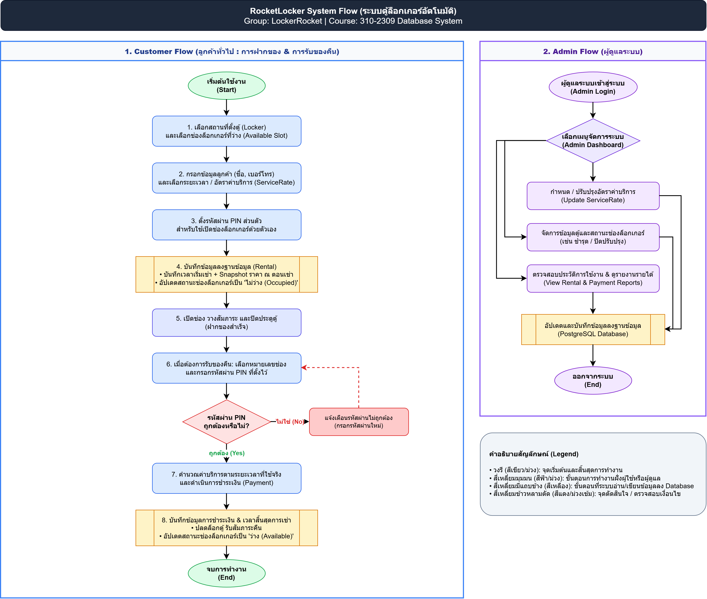
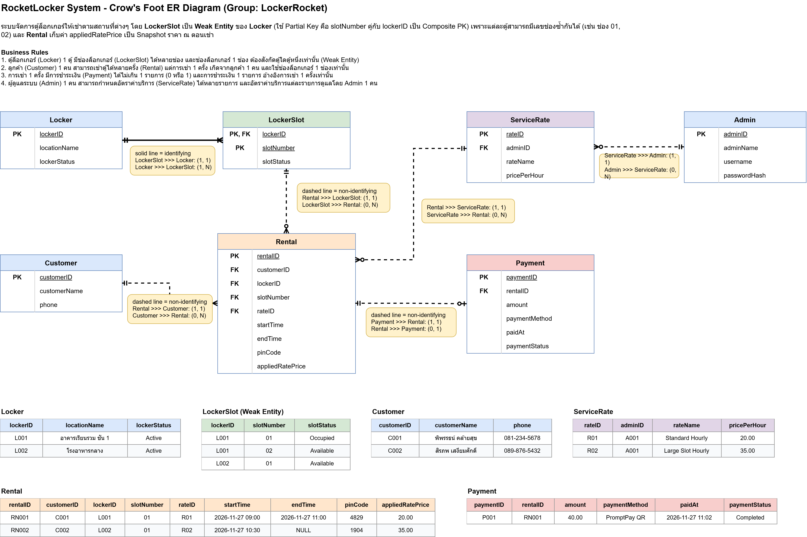

# RocketLocker

โปรเจกต์ระบบตู้ล็อกเกอร์เช่าฝากของ วิชา **310-2309 Database System**  
กลุ่ม: **LockerRocket**

---

## ระบบทำอะไรได้บ้าง
* **ลูกค้า:** เลือกตู้และช่องที่ว่าง -> ตั้งรหัส PIN เปิด-ปิดตู้เอง -> ตอนรับของคืนระบบคิดเงินตามเวลาที่ใช้จริง (ล็อกเรทราคา ณ ตอนกดเช่าไว้ให้ ไม่เปลี่ยนตามราคาใหม่ทีหลัง)
* **แอดมิน:** ปรับอัตราค่าบริการ ดูสถานะช่องล็อกเกอร์ (ว่าง/ไม่ว่าง/เสีย) และดูรายงานรายได้

**Stack:** PostgreSQL (pgAdmin 4), draw.io, Python / HTML (หน้าเว็บเอาไว้กดเทส DB)

---

## สมาชิกกลุ่ม LockerRocket

| ชื่อ - นามสกุล | รหัสนักศึกษา | ส่วนที่ดูหลักๆ |
| :--- | :---: | :--- |
| พิพรรธน์ คล้ายสุข | 6710301003 | วางโครง Repo, Flow, ERD, SQL Schema |
| ณภัทร ภูสระล้ำ | 6710301034 | *(ใส่หน้าที่ตัวเองได้เลย)* |
| สิรภพ เสงี่ยมศักดิ์ | 6710301036 | *(ใส่หน้าที่ตัวเองได้เลย)* |
| กานต์นิธิ พรมทอง | 6710301041 | *(ใส่หน้าที่ตัวเองได้เลย)* |
| ชินภัทร กันเดช | 6710301055 | *(ใส่หน้าที่ตัวเองได้เลย)* |
| ญาณพัทธ์ มิตรดำรงค์ | 6720301001 | *(ใส่หน้าที่ตัวเองได้เลย)* |
| เมธา ปลื้มไทย | 6720301002 | *(ใส่หน้าที่ตัวเองได้เลย)* |

---

## โฟลเดอร์ในโปรเจกต์
* `diagrams/` — เก็บไฟล์ `.drawio` กับรูป `.png` (แยกโฟลเดอร์ตาม week)
* `database/` — ไฟล์ SQL (`01_schema.sql` สำหรับสร้างตารางใน pgAdmin)
* `web-test/` — หน้าเว็บง่ายๆ เอาไว้กดเทสยิงข้อมูลเข้า-ออก DB

---

## วิธีทำงานร่วมกัน (กันไฟล์ตีกัน)
1. **ก่อนเริ่มแก้ไฟล์:** เปิด Terminal แล้วพิมพ์ `git pull` ดึงของล่าสุดลงเครื่องก่อนทุกครั้ง
2. **แก้รูป Diagram:** เปิดแก้ไฟล์ `.drawio` ใน draw.io หรือ VS Code เสร็จแล้วอย่าลืมกด **Export as PNG** ทับรูปชื่อเดิมด้วย (ถ้าแก้ของสัปดาห์หน้า ให้สร้างโฟลเดอร์ `week2` ใหม่ อย่าทับของเก่าใน `week1`)
3. **เทสรัน SQL:** สร้าง DB ชื่อ `rocketlocker_db` ใน pgAdmin 4 แล้วเปิด Query Tool รันไฟล์ `database/01_schema.sql`
4. **อัปเดตงานขึ้น GitHub:**
   ```bash
   git add .
   git commit -m "feat(week-02): บอกสั้นๆ ว่าทำอะไรไป"
   git push
   ```

---

## ความคืบหน้า (Weekly Checklist)

### Week 1
- [x] สรุปขอบเขตงาน (Overview, Users, Core Data)
- [x] วาด System Flow (`diagrams/week1/system-flow.png`)
- [x] วาด Crow's Foot ERD ครบ 7 ตาราง (`diagrams/week1/rocketlocker-erd.png`)
- [x] เขียน SQL สร้างตารางให้ตรงตาม ERD (`database/01_schema.sql`)
- [x] ขึ้นโครงหน้าเว็บเทส (`web-test/index.html`)
- [ ] เพิ่มข้อมูลจำลอง (`02_seed_data.sql`) กับเชื่อมหน้าเว็บเทสต่อ DB (Week 2)

#### System Flow (Week 1)


#### Crow's Foot ER Diagram (Week 1)

