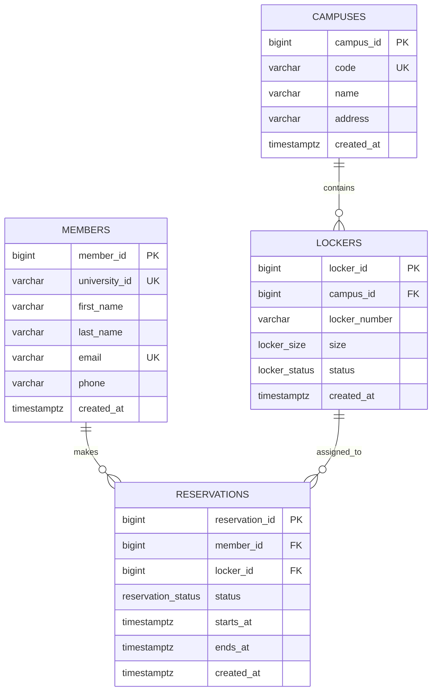

# RocketLocker Crow’s Foot ERD

Each locker is associated with exactly one campus; a campus may contain no
lockers or many lockers. Each reservation refers to exactly one member and one
locker; members and lockers may have no reservations or many reservations over
time. PostgreSQL constraints further limit a locker to one pending or active
reservation at a time.
